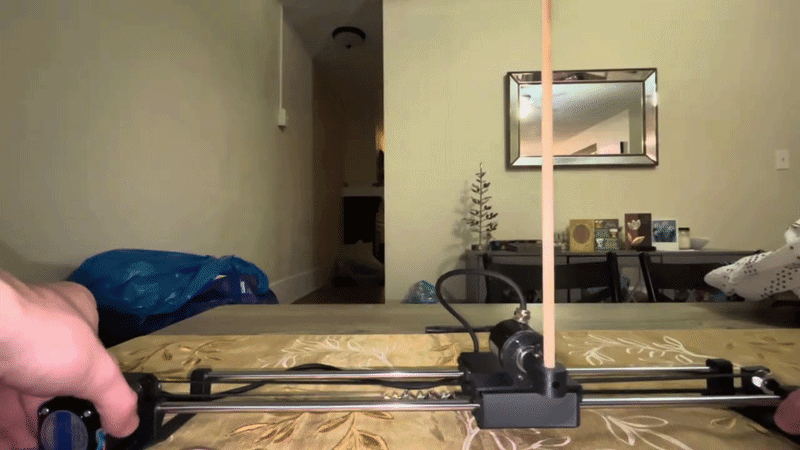
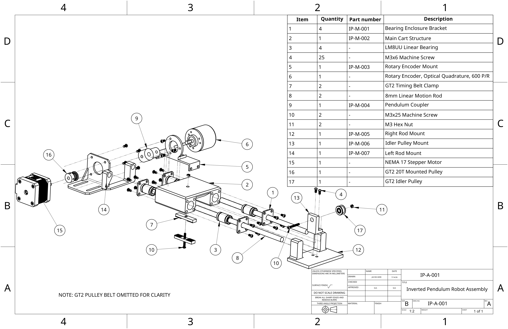
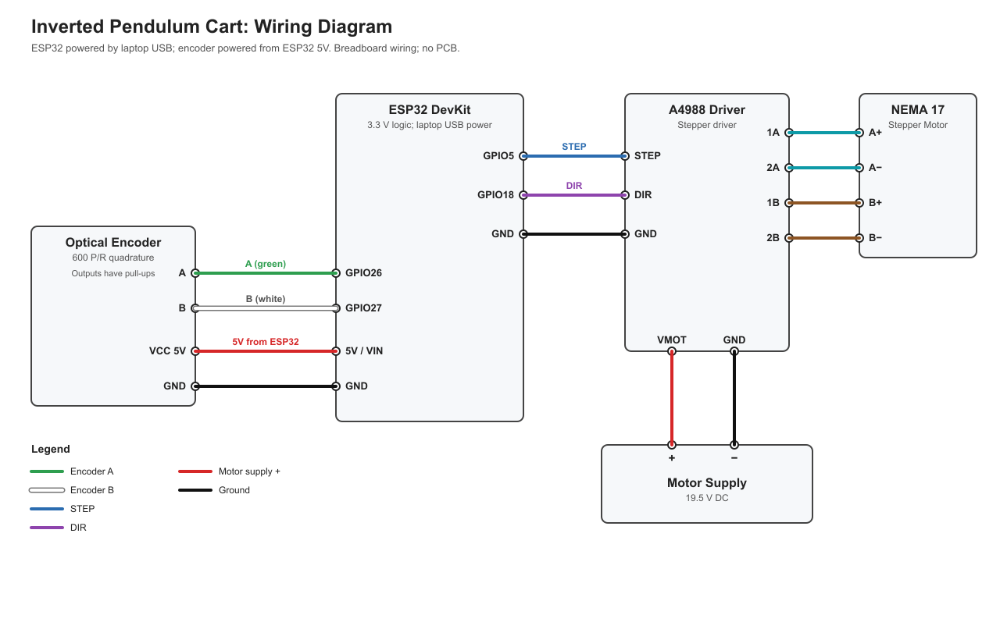

# Inverted Pendulum Balancing Robot

An inverted pendulum cart & pole system built from scratch to implement cascaded loop PID control on physical hardware. The cart balances a free swinging pendulum (mounted to encoder) by tracking its angle and accelerating a stepper motor to keep the center of mass centered.



## Hardware & Mechanical
The chassis was designed in Onshape using a mix of 3D printed mounts and standard industrial hardware.
* **Actuation:** Nema 17 stepper motor with a GT2 timing belt and 20T pulley.
* **Linear Motion:** 8mm rods with LM8UU linear bearings.
* **Documentation:** Full CAD assemblies, exploded views, and the BOM are in the repository.



## Electronics
I used an ESP32 for this project because the control loop runs at 1 kHz, which allowed accurate and precise readings of the high resolution rotary encoder.
* **Microcontroller:** ESP32
* **Feedback:** 600 P/R Optical Quadrature Rotary Encoder (mounted on the pendulum pivot)
* **Motor Driver:** A4988 Stepper Motor Driver



## Firmware
The firmware is written in C++ and uses a discrete PID controller. 
* decoding routine calculates exact angle of pendulum at any given moment, via encoder signals.
* The PID loop calculates the required correction velocity, which is translated into step and direction pulses for the A4988 driver.

---

## Repository Structure

```text
├── docs/
│   └── assets/                  # Demo GIF
├── firmware/                    # ESP32 C++ source code (main, PID, encoder)
├── hardware/
│   ├── CAD/step            # STEP files for the mechanical assemblies
│   ├── drawings/                # Exploded view and BOM (IP-A-001)
│   └── wiring/              # wiring diagram
└── README.md
